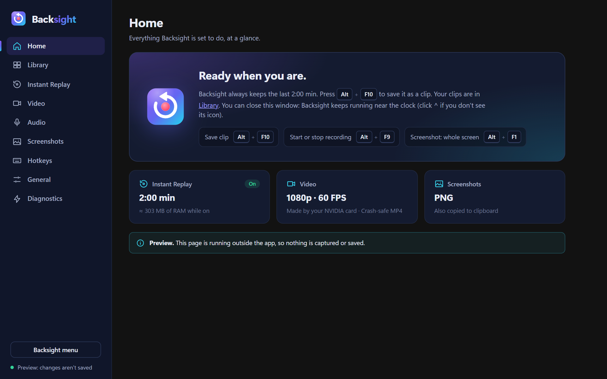

  

  
  
  

  <a href="https://github.com/backsight-app/backsight/releases/latest"><b>Download Backsight</b></a> (free, for Windows 10 and 11)

**How to install:** open the link above, download the file ending in `_x64-setup.exe` and double-click it. You don't need admin rights. Windows may say **"Windows protected your PC"** because Backsight isn't signed with a paid certificate. Click **More info**, then **Run anyway**. On first start Backsight checks your graphics card for a few seconds and suggests the best setting for it, then you can start right away. If your antivirus complains, see the [full install guide](docs/install.md).

**Backsight** saves your best gaming moments on Windows. It quietly keeps the last 2 minutes of your game, so when something great happens you press one key and it becomes a clip. It can also record whole sessions and take screenshots.

Think of it as a lighter, simpler NVIDIA ShadowPlay. Every setting comes with a short plain-English explanation, so you never have to guess what something means.

## What it does

- **Instant Replay.** The last 2 minutes are always ready. Press **Alt+C** to save them as a clip.
- **Recording.** Press **Alt+R** to start and stop. You can pause, split long recordings into parts and add markers you can jump to later.
- **Screenshots.** The whole screen, just one window, or an area you drag. They are also copied, so you can paste them straight into a chat.
- **Sound.** Your game and your microphone, with mute and push-to-talk. You can also record only the game's sound, or keep your voice on its own track.
- **The whole screen or just the game.** Record your whole monitor, or only the game's window so chats and pop-ups stay out of your clips.
- **HDR.** If you have an HDR monitor, you can turn on HDR and your clips and screenshots keep their full brightness and colour.
- **Clips named after your game,** with an optional folder per game.
- **A Library** of everything you saved, with previews.
- **It tells you what happened.** A small card and a sound for every save, and a red dot while you record. They show over your game, even with Do Not Disturb on, and you can move them anywhere.
- **Light on your PC.** In our tests Instant Replay cost a game only a few percent of its frame rate, and saving a 2-minute clip takes about as long as a blink. Closing the window frees its memory; only the small icon near the clock keeps running.
- **Built to stay out of the game.** Backsight uses Windows' own screen recording, the way screen-sharing apps do. It never injects code into a game or hooks it. That is the best we can do for anti-cheat safety, but it is no guarantee for any game: check your game's rules if you are unsure.
- **Never loses a clip.** A recording cut off by a crash or power cut is rescued the next time Backsight starts, and a saved file never replaces another one.

## Install

To update, open the General page and press **Check** under Updates, then **Install**. Your settings and clips stay. Uninstalling also keeps your clips. Backsight only goes online when you press those buttons; see the [privacy statement](docs/privacy.md).

## Use it

Backsight starts with Instant Replay on and records your main screen at 1080p, 60 frames a second.

| Key | What it does |
| --- | --- |
| **Alt+C** | Save the last 2 minutes as a clip (C for clip) |
| **Alt+Shift+C** | Turn Instant Replay on or off |
| **Alt+R** | Start or stop recording (R for record) |
| **Alt+Shift+R** | Pause or resume a recording |
| **Alt+B** | Add a marker (a bookmark) to a recording |
| **Alt+T** | Mute or unmute your microphone (T for talk) |
| **Alt+S** | Screenshot of the whole screen |
| **Alt+Shift+S** | Screenshot of the window in front |
| **Ctrl+Alt+S** | Screenshot of an area you drag |
| **Alt+Shift+O** | Open Backsight |

You can change any key on the Hotkeys page, or pick **No key** to turn one off.

You can change any of these on the Hotkeys page, including mouse side buttons. If the NVIDIA app already uses a key, setup offers different ones and Home shows which keys you have. Alt+R also opens the NVIDIA and AMD performance overlays, and Alt+C saves a Discord clip: for NVIDIA, Home's "Give Backsight other keys" button moves recording to Alt+V; for the others, pick a new key on the Hotkeys page.

Clips go to **Videos\Backsight** and screenshots to **Pictures\Backsight**. You can pick other folders in the settings.

When you close the window, Backsight keeps running near the clock. Right-click its icon to quit.

**Something wrong?** Click **Save a problem report** on the Home page. A report file appears on your desktop. Your Windows user name is removed from it, but it still lists the programs that were in front and your settings, so read it before you share it. Open an [issue](https://github.com/backsight-app/backsight/issues) and describe what happened; attach the report only if you are happy with what it says.

## Screenshots

| Every choice explained | Every clip in one place |
| --- | --- |
|  |  |
| **Home at a glance** | **Keys your way** |
|  |  |

## Good to know

- Backsight is tested on NVIDIA graphics cards with Windows 11. AMD and Intel graphics, and Windows 10, should work but have barely been tried. Feedback from those PCs is especially welcome.
- What changed lately is in the [changelog](CHANGELOG.md); what is planned is in the [roadmap](docs/ROADMAP.md).

- You are responsible for what you record. Check that you have the right to record other people's voices and copyrighted video before you share a clip.

## For developers (building from source)

You don't need this to use Backsight; download it above. Backsight is written in Rust with a Tauri and Svelte window. To build it on a fresh PC, run `scripts/build.ps1`; to run the tests or help out, start with [CONTRIBUTING.md](CONTRIBUTING.md) and [docs/DEVELOPMENT.md](docs/DEVELOPMENT.md). The rest of the technical documentation (how it works, design decisions, testing) is listed in [docs/README.md](docs/README.md).

## Thanks

Backsight stands on a lot of free software, above all [FFmpeg](https://ffmpeg.org) (encoding and video files), [Tauri](https://tauri.app) and [Svelte](https://svelte.dev) (the window), [Rust](https://www.rust-lang.org) with Microsoft's [`windows` crate](https://github.com/microsoft/windows-rs) (talking to Windows), and [rsmpeg](https://github.com/larksuite/rsmpeg) (FFmpeg from Rust). Full credits ship with the app as `THIRD-PARTY-NOTICES.txt` and appear in the About section of the General page.

## Privacy and safety

[Privacy statement](docs/privacy.md). To report a security problem, see [SECURITY.md](SECURITY.md).

## License

[GPL-3.0-or-later](LICENSE). Backsight uses FFmpeg built with GPL parts; see [ADR 0005](docs/adr/0005-license-gpl.md). Backsight comes with no warranty, as the license says.

NVIDIA, GeForce, ShadowPlay, AMD, Radeon and Intel are trademarks of their respective owners. Backsight is not affiliated with or endorsed by them, or by any game or game company.
