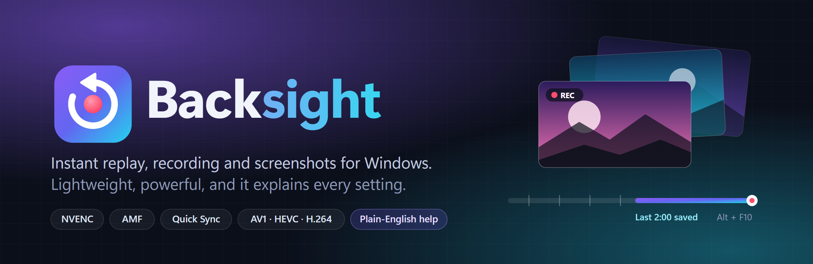
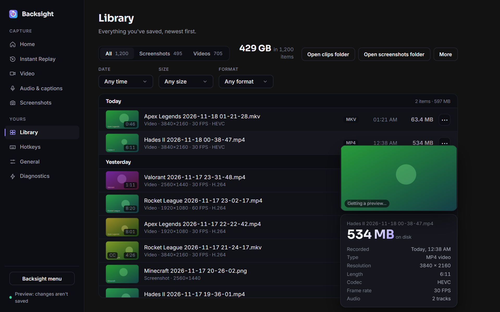
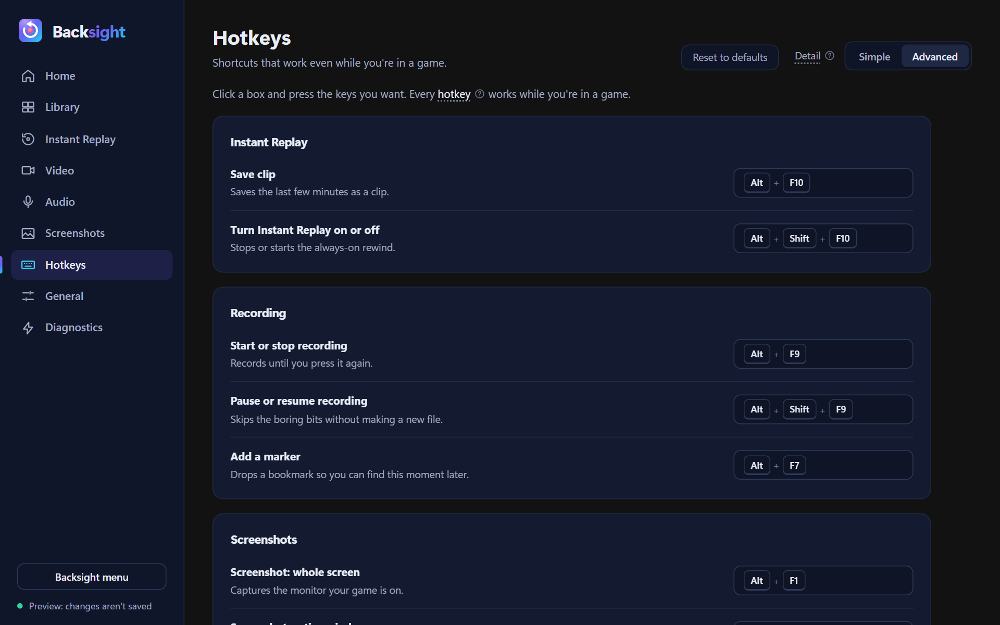

<p align="center">
  
</p>

<p align="center">
  <a href="https://github.com/backsight-app/backsight/releases/latest"></a>
  <a href="https://github.com/backsight-app/backsight/releases"></a>
  <a href="https://github.com/backsight-app/backsight/actions/workflows/ci.yml"></a>
  <a href="LICENSE"></a>
  
  
</p>

<p align="center">
  <b><a href="https://github.com/backsight-app/backsight/releases/latest">Download</a></b> ·
  <a href="docs/README.md">Documentation</a> ·
  <a href="CHANGELOG.md">Changelog</a> ·
  <a href="docs/ROADMAP.md">Roadmap</a> ·
  <a href="https://github.com/backsight-app/backsight/issues/new/choose">Report a bug</a> ·
  <a href="SECURITY.md">Security</a>
</p>

**Backsight** is a lightweight instant replay, screen recording and screenshot tool for Windows. It captures with Windows.Graphics.Capture, encodes on the GPU and never injects into games.

## Features

### Major

- **Instant Replay**: the last 2 minutes (adjustable) kept in RAM; a clip saves in under a second without re-encoding.
- **Recording**: start, stop, pause, split, markers as chapters, crash recovery.
- **Screenshots**: screen, window or region; PNG, JPEG, WebP or JPEG XR (HDR); copied to the clipboard.
- **Hardware encoding**: NVIDIA NVENC, AMD AMF and Intel Quick Sync with zero-copy GPU frames; x264, x265, SVT-AV1 and AOM on the CPU.
- **HDR**: 10-bit HEVC video and JPEG XR screenshots.
- **Vertical clips**: 9:16 copies for Shorts, TikTok and Reels.
- **On-device captions**: whisper.cpp speech-to-text, `.srt` files or burned into vertical clips.
- **Hotkey clash detection**: finds overlay, chat and capture apps that share Backsight's keys and offers free ones.
- **Automatic updates**: signed releases from GitHub.

### Minor

- Monitor or game-window capture; clips named after the game, optional per-game folders.
- Desktop or game-only audio, microphone with mute and push-to-talk, separate tracks.
- Library with thumbnails, hover previews and filters.
- Pop-ups, sounds and a recording dot that show over games and during Do Not Disturb.
- Hotkeys through Raw Input, including mouse side buttons; any action can be unbound.
- Encoder test and recommended setting on first run; overload warning with a lighter setting.
- Diagnostics page with live engine counters; local problem and crash reports.
- Tray mode, Start with Windows, per-user install without admin rights.
- Measured overhead: about 1.6% FPS for replay plus recording over capture alone ([testing](docs/architecture/testing.md)).

## Screenshots

| Home | Library |
| --- | --- |
|  |  |
| **Video settings** | **Hotkeys** |
|  |  |

## Requirements

| | |
| --- | --- |
| OS | Windows 10 2004 (19041) or later, Windows 11 |
| Runtime | WebView2 (included in Windows 11; installed by the setup when missing) |
| GPU | NVIDIA and Intel Quick Sync verified; AMD supported, not yet verified; CPU encoding everywhere |
| Captions | CPU with AVX2 |

## Default hotkeys

| Key | Action | Key | Action |
| --- | --- | --- | --- |
| Alt+C | Save clip | Alt+S | Screenshot |
| Alt+Shift+C | Replay on/off | Alt+Shift+S | Window screenshot |
| Alt+R | Record start/stop | Ctrl+Alt+S | Region screenshot |
| Alt+Shift+R | Pause/resume | Alt+T | Microphone mute |
| Alt+B | Marker | Alt+Shift+O | Open Backsight |

Output: `Videos\Backsight` and `Pictures\Backsight`.

## Install

Run `Backsight_<version>_x64-setup.exe` from the [latest release](https://github.com/backsight-app/backsight/releases/latest). The installer is not Authenticode-signed; SmartScreen needs **More info → Run anyway**. Details: [install guide](docs/install.md).

## Build from source

Requires Rust (MSVC), Visual Studio 2022 Build Tools, Node.js 22+, libclang and CMake ([full list](docs/DEVELOPMENT.md#prerequisites)). `build.ps1` checks them, fetches the pinned FFmpeg build and produces the installer.

```powershell
git clone https://github.com/backsight-app/backsight
cd backsight
./scripts/build.ps1
```

## Documentation

| Users | Developers | Project |
| --- | --- | --- |
| [Install and update](docs/install.md) | [Development setup](docs/DEVELOPMENT.md) | [Changelog](CHANGELOG.md) |
| [Privacy](docs/privacy.md) | [Architecture overview](docs/architecture/overview.md) | [Roadmap](docs/ROADMAP.md) |
| [Hotkeys](docs/architecture/hotkeys.md) | [Capture pipeline](docs/architecture/capture-pipeline.md) | [Contributing](CONTRIBUTING.md) |
| | [Replay buffer](docs/architecture/replay-buffer.md) | [Security policy](SECURITY.md) |
| | [Audio](docs/architecture/audio.md) | [Decision records (ADRs)](docs/adr/README.md) |
| | [Library](docs/architecture/library.md) | [Brand and voice](docs/design/brand-and-voice.md) |
| | [Settings and content](docs/architecture/settings-and-content.md) | [License](LICENSE) |
| | [Testing](docs/architecture/testing.md) | [Third-party notices](THIRD-PARTY-NOTICES.txt) |
| | [Platform notes](docs/reference/platform-notes.md) | |

## Built with

| Component | Used for | License |
| --- | --- | --- |
| [Rust](https://www.rust-lang.org) | Engine and app | MIT / Apache-2.0 |
| [windows-rs](https://github.com/microsoft/windows-rs) | Windows APIs: capture, Direct3D 11, WASAPI, Raw Input | MIT / Apache-2.0 |
| [Tauri 2](https://tauri.app) | App shell, tray, updater | MIT / Apache-2.0 |
| [WebView2](https://developer.microsoft.com/microsoft-edge/webview2/) | Window rendering | Microsoft |
| [Svelte 5](https://svelte.dev), [Vite](https://vite.dev), [TypeScript](https://www.typescriptlang.org) | User interface | MIT / Apache-2.0 |
| [Floating UI](https://floating-ui.com) | Tooltips and menus | MIT |
| [FFmpeg 8.1](https://ffmpeg.org) | Encoding and muxing (slim build) | GPL-2.0-or-later (this build) |
| [x264](https://www.videolan.org/developers/x264.html), [x265](https://www.x265.org), [SVT-AV1](https://gitlab.com/AOMediaCodec/SVT-AV1), [libaom](https://aomedia.googlesource.com/aom/), [dav1d](https://code.videolan.org/videolan/dav1d), [Opus](https://opus-codec.org), [libwebp](https://chromium.googlesource.com/webm/libwebp), [oneVPL](https://github.com/intel/libvpl), [AMF](https://github.com/GPUOpen-LibrariesAndSDKs/AMF), [nv-codec-headers](https://github.com/FFmpeg/nv-codec-headers), [zlib](https://zlib.net) | Codecs and GPU encoders inside FFmpeg | GPL-2.0+ / BSD / MIT / zlib |
| [rsmpeg](https://github.com/larksuite/rsmpeg) | Rust bindings for FFmpeg | MIT |
| [whisper.cpp](https://github.com/ggml-org/whisper.cpp), [whisper-rs](https://crates.io/crates/whisper-rs) | On-device captions | MIT / Unlicense |
| [Whisper](https://github.com/openai/whisper) base model, [Silero VAD](https://github.com/snakers4/silero-vad) | Speech recognition and voice detection models | MIT |
| [serde](https://serde.rs), [toml](https://github.com/toml-rs/toml), [tracing](https://github.com/tokio-rs/tracing), [reqwest](https://github.com/seanmonstar/reqwest) | Settings, logs, downloads | MIT / Apache-2.0 |
| [Inter](https://rsms.me/inter/), [Sora](https://fonts.google.com/specimen/Sora) | Fonts | OFL-1.1 |
| [NSIS](https://nsis.sourceforge.io) | Installer | zlib |
| [cargo-about](https://github.com/EmbarkStudios/cargo-about) | Third-party notices | MIT / Apache-2.0 |
| [GitHub Actions](https://github.com/features/actions), [tauri-action](https://github.com/tauri-apps/tauri-action) | CI, FFmpeg builds, signed releases | MIT |

Every dependency and its license: [THIRD-PARTY-NOTICES.txt](THIRD-PARTY-NOTICES.txt), also under About in the app.

## Privacy

No account, analytics or telemetry. Network access is limited to update checks and the optional captions model download. Problem reports are saved locally and never sent. [Privacy statement](docs/privacy.md).

## License

[GPL-3.0-or-later](LICENSE). The bundled FFmpeg is a GPL build; its source is published as a [release](https://github.com/backsight-app/backsight/releases/tag/ffmpeg-8.1.3-slim-r1) ([ADR 0005](docs/adr/0005-license-gpl.md)). No warranty.

<sub>NVIDIA, GeForce, AMD, Radeon, Intel, Discord, Steam, OBS and Xbox are trademarks of their respective owners. Backsight is not affiliated with or endorsed by them, or by any game or game company.</sub>
