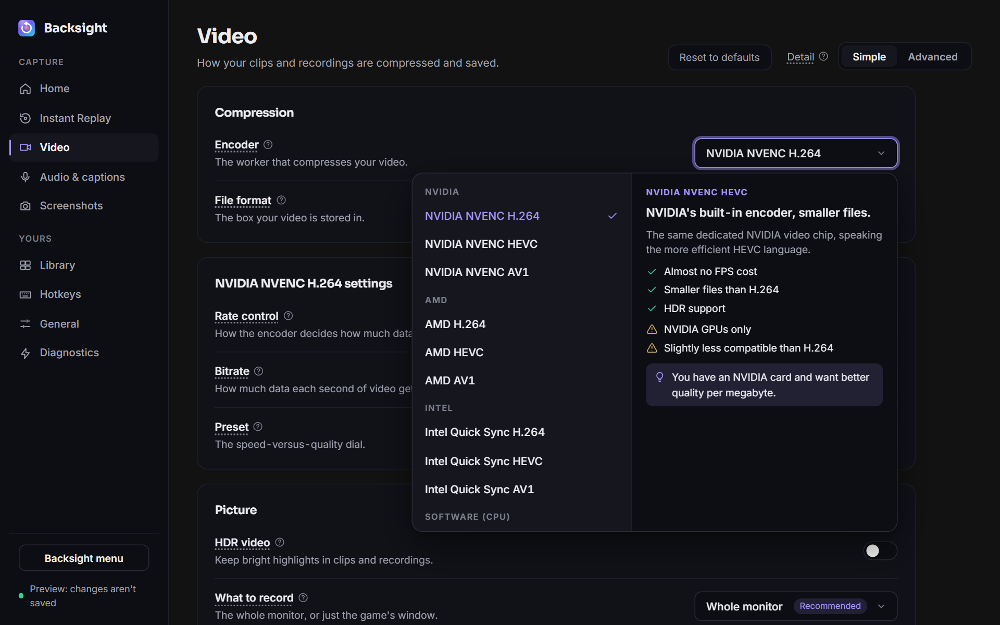

  

  
  
  

  <a href="https://github.com/backsight-app/backsight/releases/latest"><b>Download Backsight</b></a> · free, for Windows 10 and 11

**Backsight** is a lightweight game clipper for Windows. Instant Replay keeps the last 2 minutes in memory, and one key saves them as a clip. It also records whole sessions and takes screenshots. Every setting carries a short explanation.

## Features

- **Instant Replay.** The last 2 minutes (adjustable) are always ready; saving a clip takes well under a second and costs no extra encoding.
- **Vertical clips.** Each clip can also, or instead, be saved as a 9:16 clip for YouTube Shorts, TikTok and Reels. The crop runs in the background after the save.
- **Captions.** Optional, on-device speech-to-text (whisper.cpp). Each clip gets a `.srt` file; vertical clips get the captions burned into the picture. Nothing is sent anywhere.
- **Recording.** Start, stop, pause, split into parts and add markers, which become chapters. A recording cut off by a crash or power loss is recovered at the next start.
- **Screenshots.** Whole screen, active window or a dragged region, in PNG, JPEG or WebP, copied to the clipboard.
- **Audio.** Desktop or game-only sound, a microphone with mute and push-to-talk, and optional separate tracks.
- **Monitor or game window.** Capture a chosen monitor, or only the game's window so other apps stay out of the clip.
- **HDR.** Optional 10-bit HDR video (NVIDIA HEVC) and JPEG XR screenshots on HDR monitors.
- **Library.** Every clip, recording and screenshot with thumbnails, hover previews and filters. Files can be named after the game, with optional per-game folders.
- **Notifications that show over games.** Backsight's own pop-ups, sounds and a movable recording dot, also with Do Not Disturb on.
- **Automatic updates.** Signed updates from GitHub Releases. One found shortly after start, before a game or recording, installs by itself; otherwise Home offers **Restart to update**.
- **Low overhead.** Hardware encoding with zero-copy GPU frames. Measured cost of replay plus recording: about 1.6% FPS over Windows capture alone in a GPU-bound game ([testing.md](docs/architecture/testing.md)). Closing the window frees its memory; only the tray icon and engine keep running.
- **No injection.** Capture uses Windows.Graphics.Capture, the API screen-sharing apps use. Backsight never injects code into or hooks a game. This is the safest approach for anti-cheat, not a guarantee; check a game's rules when in doubt.

## Install

Download `Backsight_<version>_x64-setup.exe` from the [latest release](https://github.com/backsight-app/backsight/releases/latest) and run it. It installs per user and needs no admin rights. The installer is not Authenticode-signed, so SmartScreen shows "Windows protected your PC": choose **More info**, then **Run anyway**. On first start Backsight tests the graphics card's encoders and recommends a setting.

Backsight checks for updates by itself and keeps settings and clips across them. Uninstalling keeps clips and screenshots. Details and antivirus notes: [install guide](docs/install.md).

## Requirements

- Windows 10 version 2004 (build 19041) or later, or Windows 11
- WebView2 (included in Windows 11; the installer fetches it when missing)
- Verified on NVIDIA GPUs and Intel Quick Sync (Iris Xe) with Windows 11. AMD encoders have a code path but are not yet verified on hardware; CPU encoding (x264) works everywhere.
- Captions need a CPU with AVX2.

## Default hotkeys

| Key | Action |
| --- | --- |
| **Alt+C** | Save the last 2 minutes as a clip |
| **Alt+Shift+C** | Turn Instant Replay on or off |
| **Alt+R** | Start or stop recording |
| **Alt+Shift+R** | Pause or resume recording |
| **Alt+B** | Add a marker to a recording |
| **Alt+T** | Mute or unmute the microphone |
| **Alt+S** | Screenshot of the whole screen |
| **Alt+Shift+S** | Screenshot of the active window |
| **Ctrl+Alt+S** | Screenshot of a region |
| **Alt+Shift+O** | Open Backsight |

Keys, including mouse side buttons, are set on the Hotkeys page; any action can have no key. Alt+R also opens the NVIDIA and AMD performance overlays, and Alt+C is Discord's clip key. When the NVIDIA app's overlay claims a key, Home offers **Give Backsight other keys** (Alt+X / Alt+Shift+X for clips, Alt+V / Alt+Shift+V for recording).

Clips and recordings are saved to `Videos\Backsight`, screenshots to `Pictures\Backsight`. Closing the window leaves Backsight running in the tray; quit from the tray icon's menu.

## Screenshots

| Every choice explained | Every clip in one place |
| --- | --- |
|  |  |
| **Home** | **Hotkeys** |
|  |  |

## Privacy

Backsight has no account, analytics, telemetry or advertising. It connects to GitHub only to check for and download updates and, when requested, the captions models. Clips, captions and settings never leave the PC. See the [privacy statement](docs/privacy.md).

**Problem reports.** Home's **Save a problem report** writes a file to the desktop; nothing is sent. The Windows user name is removed, but the report lists settings and the programs that were in front, so review it before attaching it to an [issue](https://github.com/backsight-app/backsight/issues). Security issues: [SECURITY.md](SECURITY.md).

Users are responsible for what they record and share, including other people's voices and copyrighted material.

## Status

Changes: [CHANGELOG.md](CHANGELOG.md). Plan and open items: [ROADMAP.md](docs/ROADMAP.md).

## Building from source

Backsight is written in Rust with a Tauri 2 and Svelte window. `scripts/build.ps1` checks the prerequisites and builds the installer on a clean PC. See [CONTRIBUTING.md](CONTRIBUTING.md), [docs/DEVELOPMENT.md](docs/DEVELOPMENT.md) and the [documentation index](docs/README.md).

## Acknowledgements

Backsight builds on [FFmpeg](https://ffmpeg.org), [Tauri](https://tauri.app), [Svelte](https://svelte.dev), [Rust](https://www.rust-lang.org) with Microsoft's [`windows` crate](https://github.com/microsoft/windows-rs), [rsmpeg](https://github.com/larksuite/rsmpeg) and [whisper.cpp](https://github.com/ggml-org/whisper.cpp). Full credits ship with the app as `THIRD-PARTY-NOTICES.txt` and appear under About on the General page.

## License

[GPL-3.0-or-later](LICENSE). The bundled FFmpeg is a GPL build; its complete source is published as a [release](https://github.com/backsight-app/backsight/releases/tag/ffmpeg-8.1.3-slim-r1) of this repository ([ADR 0005](docs/adr/0005-license-gpl.md)). Backsight comes with no warranty.

NVIDIA, GeForce, ShadowPlay, AMD, Radeon, Intel and Discord are trademarks of their respective owners. Backsight is not affiliated with or endorsed by them, or by any game or game company.
