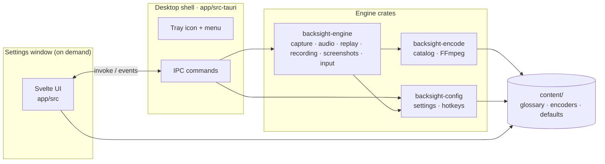
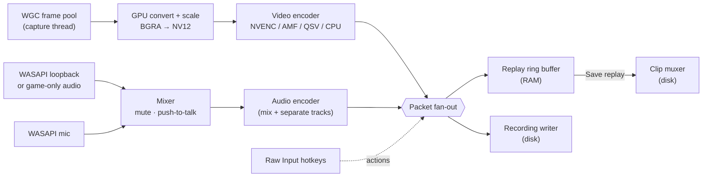

# Architecture overview

Backsight is one Windows process with two halves:

- **The engine** (Rust, always running): capture, encoding, Instant Replay, recording, recovery, screenshots and hotkeys.
- **The settings window** (Tauri + Svelte, on demand): a WebView that exists only while you have it open.

Closing the window destroys the WebView (about 80–150 MB) and leaves only the tray icon and the engine. That is what "lightweight" means here: while you play, nothing but the capture pipeline is resident.

## Goals and non-goals

| Goals | Non-goals |
| --- | --- |
| ShadowPlay-level features without the NVIDIA overlay | Live streaming (RTMP/SRT). The muxer could support it later |
| Near-zero FPS cost through hardware encoders and zero-copy GPU paths | Scene composition, sources and filters like OBS |
| Every setting understandable by a non-expert | Video editing beyond quick trims (later) |
| Anti-cheat safe: no injection, no hooks | Linux or macOS |

### Deliberately out of scope

These were considered and rejected. Adding any of them needs a new ADR.

| Not doing | Why |
| --- | --- |
| Graphics API hooking or DLL injection (DX9/11/12, Vulkan, OpenGL) | Anti-cheat flags and bans; five hook codebases to maintain. WGC covers modern games ([ADR 0004](../adr/0004-wgc-capture-no-injection.md)) |
| Plugin system, Lua or Rhai scripting | That's OBS. Useful automations (such as "start replay when a game launches") are built in |
| Raw-frame replay buffer | About 20 GB for 2 minutes at 1080p. We buffer encoded packets (about 300 MB) |
| Saving and restoring encoder state | Not possible for hardware encoders in any useful way. Crash-safe containers handle recovery |
| Lock-free replay buffer | It's touched about 100 times a second; a short mutex is far below any cost that matters |
| In-game overlay or HUD | Can't draw over fullscreen games without injection. The app's Diagnostics view covers it |
| Byte-exact or bitrate-exact "golden" encoder outputs | Hardware encoder output changes with every driver. Quality is tested with thresholds ([testing.md](testing.md)) |
| Cross-architecture float determinism | x86-64 Windows only, and audio mixing doesn't need bit-identical results |

**Minimum OS:** Windows 10 version 2004 (build 19041), needed for per-process audio loopback. Windows 11 removes the yellow capture border.

## Components

| Crate / folder | Responsibility | Depends on |
| --- | --- | --- |
| `crates/backsight-config` | Settings schema, defaults, atomic save/load, hotkey parsing and conflicts | `content/default-settings.json` |
| `crates/backsight-encode` | Encoder catalog and option mapping; FFmpeg encode, mux, MKV → MP4 remux, screenshot encoding, encoder probe, the vertical crop and burned-in captions (`vertical.rs`, `burn.rs`) | config, `content/encoders.json` |
| `crates/backsight-engine` | WGC capture, WASAPI audio and mixer, replay buffer, sessions, recording, recovery of interrupted recordings, vertical clip jobs ([ADR 0015](../adr/0015-vertical-clips.md)), screenshots, Raw Input hotkeys, library, start with Windows | config, encode |
| `crates/backsight-captions` | Captions for saved clips: the model download, the queue that runs one low-priority captions process at a time, speech finding and Whisper (whisper.cpp), `.srt` writing ([ADR 0016](../adr/0016-on-device-captions.md)) | config, encode |
| `app/src-tauri` | Tray, window lifecycle, notifications, the region picker window, updates (`update.rs`, [ADR 0014](../adr/0014-updates-from-github-releases.md)), the captions process (`--captions`), IPC bridge between UI and engine | config, engine |
| `app/src` | Settings UI (Home, Library, Instant Replay, Video, Audio, Screenshots, Hotkeys, General, Diagnostics), tooltips, hotkey editor, region picker | `content/*` |

Rules that keep this clean:

1. **The UI never talks to Windows or FFmpeg.** It reads and writes settings and sends commands. The engine owns all platform code.
2. **One source of truth for options.** Encoders, options, defaults and explanations live in `content/`. Rust and TypeScript both read the same files, and tests fail if they drift (see [settings-and-content.md](settings-and-content.md)).
3. **Platform code stays at the edges.** `windows` crate calls live in small modules (`capture/wgc.rs`, `audio/wasapi.rs`, `input/raw_input.rs`). Core logic like the replay buffer is plain Rust with unit tests.

## Runtime model

- **One encoder feeds both** Instant Replay and recording, so recording while the replay buffer is on costs nothing extra. A recording starts on the newest keyframe in the replay buffer. It works with Instant Replay on or off; turning replay off during a recording only shrinks the buffer.
- **Threads:** capture (WGC free-threaded callbacks, which also convert each frame on the GPU), a video thread that paces and encodes, one thread per audio source, an audio worker that mixes and encodes, a writer thread for the recording file, and an input thread with a message-only window. Frames are never queued: the video thread encodes the latest one. Encoded packets reach the writer through a bounded, pooled queue.
- **Clock:** every sample is stamped with QPC (`QueryPerformanceCounter`) microseconds when captured, so audio and video share one timeline.
- **Pause, split and markers:** the recording feed cuts at keyframes. A pause leaves out the same span of sound and picture, a split starts the next file on a keyframe, and a marker becomes a chapter. Details in [capture-pipeline.md](capture-pipeline.md).
- **Failure policy:** an encoder error stops the session but keeps the replay buffer, so what was captured can still be saved. A full or slow disk stops the recording and keeps what was written. The settings file is never overwritten after a failed read.
- **Monitor changes:** capture moves when the monitor picked on the Video page comes back (or, in window mode with HDR video on, when the game is dragged to a monitor of the other kind). The move starts a new session, which may record another size or HDR, so the replay so far is kept beside it: the next clip saved also writes it as a separate file. It is trimmed as time passes, so it and the new replay together never hold more than the replay length (nor more RAM than the replay's ceiling), and only the last two moves are kept. A session that stops on its own is restarted a few times with growing waits; monitor changes start at most three fresh rounds of that, then Instant Replay stays off with a pop-up saying why. The monitor list is asked for outside the replay lock, every 5 s, and only while a monitor-mode replay could move.
- **After a save:** with Clip shape Vertical or Both, a background job crops the saved clip to 9:16 and encodes it; with captions on, a separate low-priority process transcribes it first. Neither holds the save ([ADR 0015](../adr/0015-vertical-clips.md), [ADR 0016](../adr/0016-on-device-captions.md)).
- **Interrupted recordings:** a recording in progress is named `<final name>.recording.part`. If Backsight crashes or Windows shuts down, the next start copies what plays into a normal file and keeps the original as `.recovered.part` ([ADR 0008](../adr/0008-interrupted-recording-files.md)). Quitting Backsight normally finishes a running recording.
- **Nothing the user does waits for the encoder.** Opening a session takes seconds on some PCs (NVENC can take 6 to 9 s on Optimus laptops), so the slow work runs on worker threads and the rules live in `app/src-tauri/src/respond.rs`:
  - *Saving settings* writes the file and returns; a background worker brings the engine in line, newest save only (saves made meanwhile replace each other, none waits in line).
  - *The record key and the replay toggle* each run on their own thread, one press at a time. A press of the same key while the last one is still being carried out is **dropped, not queued and not a cancel**: a second press is nearly always impatience, and stopping a recording the user believes is running would lose their footage. The first press is answered at once with the start sound and a "Starting the recording" pop-up; the sound plays again when recording really begins. Other keys (save clip, screenshot, marker, mute) never wait behind them.
  - *Quit* hides the tray icon and windows at once; a worker finishes a running recording and the files being written, then the process ends.
  - *The same problem pop-up* isn't stacked again within 10 s; its sound still answers each press.
  - *The first encoder open* is paid once after startup when Instant Replay is off (`session::warm_up` opens and closes the chosen encoder), so the first recording starts sooner. Nothing stays open at idle.
- **Settings changes:** most capture, encoder and audio settings restart the session. Recording-only settings (split length, convert to MP4) and screenshot settings apply without touching the replay buffer, and most hotkey changes only restart the hotkey listener (turning push-to-talk on or off also restarts the session).

## Performance budget

| Metric | Budget | How we measure |
| --- | --- | --- |
| FPS cost, 1080p60 NVENC, replay on | under 5% over WGC capture alone | PresentMon A/B ([testing.md](testing.md)) |
| Engine RAM, excluding replay buffer | under 150 MB (measured ~75 MB with the default settings) | Task Manager private working set |
| CPU while idle with replay on | under 1% | 60 s average on a 6-core CPU |
| Clip save latency | under 1 s for 2 min at 20 Mbps | Hotkey to file closed |
| Window closed | no WebView process | `msedgewebview2.exe` count |

## Where to go next

- Capture and encoding details: [capture-pipeline.md](capture-pipeline.md)
- Instant Replay internals: [replay-buffer.md](replay-buffer.md)
- Sound sources, mixing and device changes: [audio.md](audio.md)
- Hotkeys: [hotkeys.md](hotkeys.md)
- The media library (scan, cache, hover previews): [library.md](library.md)
- Why Rust, Tauri, FFmpeg and WGC: [ADRs](../adr/README.md)
