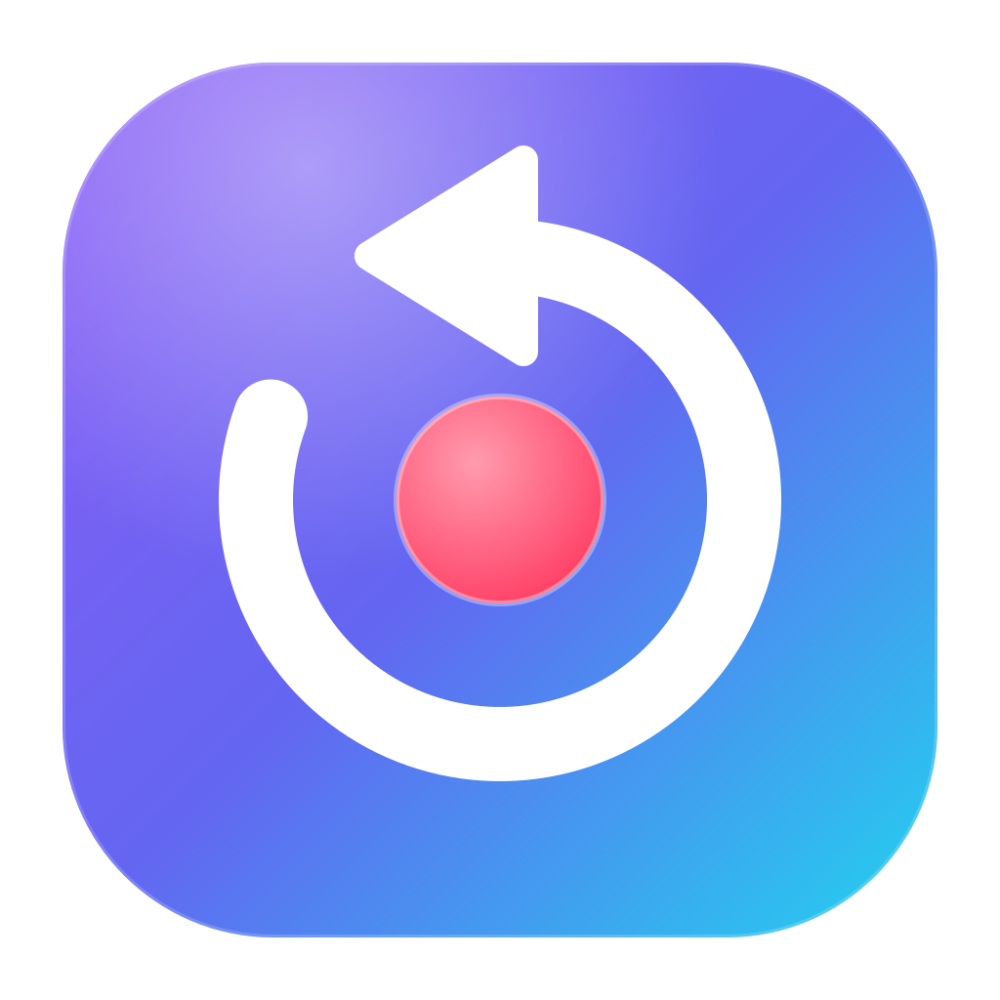

# Brand and voice

## The mark

A **rewind ring** around a **record dot**: Instant Replay and recording in one shape. The ring runs clockwise from 12 o'clock to 8 o'clock, and the arrow at the top points back in time.

| File | Use |
| --- | --- |
| `assets/brand/backsight-mark.svg` | Source of truth for the app icon and in-app logo |
| `assets/brand/backsight-mark-1024.png` | Input for `tauri icon` |
| `assets/brand/banner.svg` / `.png` | README header |
| `assets/brand/social-preview.svg` / `.png` | GitHub social preview (Settings → General → Social preview) |

Keep clear space of at least 25% of the mark's width around it. Don't recolor the ring, rotate the mark, or put it on a busy photo.

## Color

| Token | Hex | Use |
| --- | --- | --- |
| Violet | `#8B5CF6` | Gradient start, accents |
| Indigo | `#6366F1` | Gradient middle |
| Cyan | `#22D3EE` | Gradient end, links, info |
| Record | `#FF4D6D` | Recording state, conflicts. Never decorative |
| Background | `#0B0F1A` | App and banner background |
| Card | `#141B30` | Surfaces |
| Text | `#E9EDF7` / `#A3ADC6` / `#6F7A96` | Primary / secondary / faint |

The signature gradient is `135°, #8B5CF6 → #6366F1 → #22D3EE`. Full UI tokens are in `app/src/app.css`.

## Type

Segoe UI Variable, which ships with Windows, so there's nothing to download: **Display** for headings and the wordmark (700 weight, -0.02em tracking), **Text** for everything else. In the wordmark "Back" is white and "sight" carries the gradient.

## Voice: how we explain things

Backsight talks like a friend who knows video, not like a spec sheet.

1. **`short` is one line, under 10 words.** It says what the setting *does*, not what it *is*. "How much data each second of video gets," not "Target bitrate in kbps."
2. **`eli5` is at most 3 sentences** and uses one everyday comparison when it helps (a tap, a box, a language). Define jargon in the same sentence, or don't use it.
3. **Give numbers people can act on.** "15–25 Mbps for 1080p60," "about 11 MB per minute."
4. **`pros` and `cons` have at most 3 items each**, short fragments, no trailing periods.
5. **`pickIf` is one sentence** starting from the user's situation: "You have an NVIDIA card and…"
6. **Be honest about trade-offs.** Never call an option "best" without saying for what.
7. **Say "you," not "the user."** No exclamation marks. No blame ("invalid input"); say what to do instead.
